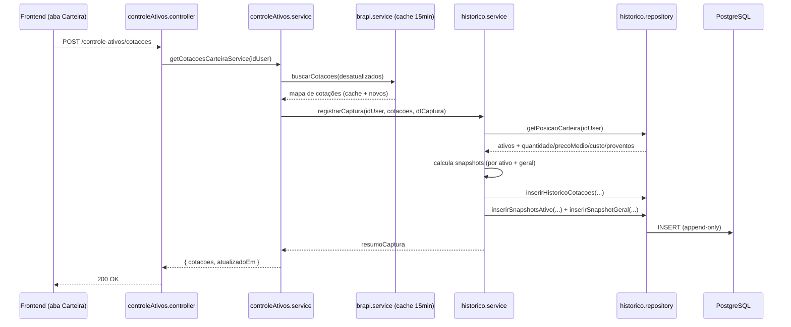
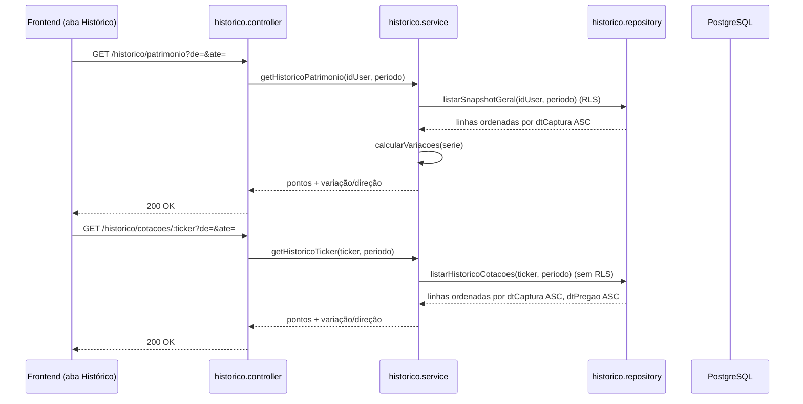
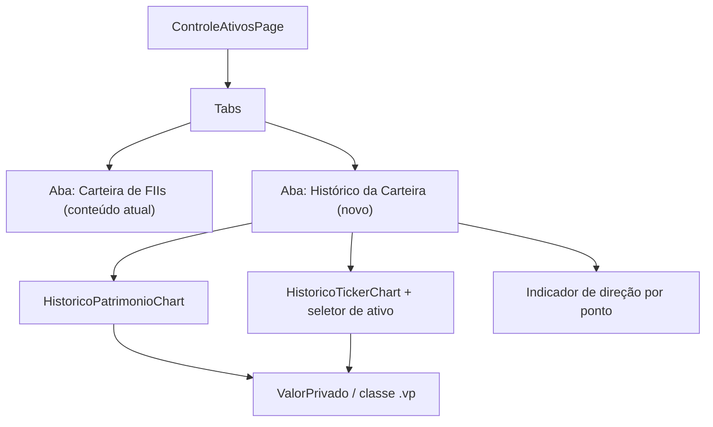

# Design Document — Histórico da Carteira

## Overview

O recurso **Histórico da Carteira** adiciona rastreabilidade temporal ao FII-Track. Hoje a tabela `cotacoes` (migration 002) guarda apenas a última cotação por ticker via UPSERT, perdendo o histórico. Este design introduz duas tabelas append-only e um novo módulo backend (`historico`) que grava um snapshot a cada clique em "Atualizar Cotações", além de reorganizar a tela de Controle de Ativos em duas abas no frontend.

O recurso captura duas dimensões complementares a cada **Captura** (evento disparado por um acionamento de atualização, identificado por um `dtCaptura`):

1. **Histórico de preço de mercado por ticker** — `Historico_Cotacoes`: dado de mercado, compartilhado entre usuários, **sem RLS**, seguindo o modelo da tabela `cotacoes`.
2. **Snapshot do patrimônio da carteira** — `Historico_Carteira`: dado privado por `idUser`, **com RLS**, contendo o snapshot por ativo e o snapshot geral consolidado.

Princípios de design que orientam as decisões abaixo:

- **Append-only**: nenhuma Captura sobrescreve outra. O agrupamento por dia é aplicado apenas na visualização (Requirement 5.5).
- **Reuso do cache existente**: a gravação reaproveita o fluxo de `getCotacoesCarteiraService` (TTL de 15 min), sem consultar a brapi quando o cache está fresco (Requirement 1.4).
- **Precisão preservada**: os valores de mercado gravados em `Historico_Cotacoes` mantêm a precisão recebida da fonte (Requirement 1.2); os cálculos de patrimônio arredondam para 2 casas (Requirement 3).
- **Consistência com convenções**: módulo em `src/modules/historico/` com `*.controller.js`, `*.service.js`, `*.repository.js`, `*.routes.js`; migrations idempotentes `004+`; RLS via `current_setting('app.current_user_id')`.

### Requisitos endereçados

Este design cobre os 8 requisitos: gravação de histórico ao atualizar cotações (R1), histórico de preço por ticker (R2), snapshot de patrimônio por ativo e geral (R3), cálculo de variação (R4), visualização em abas com agrupamento por dia (R5), respeito ao modo de privacidade (R6), RLS por usuário (R7) e migrations/permissões (R8).

## Architecture

### Fluxo de gravação (Captura)

O acionamento de "Atualizar Cotações" continua entrando pela rota existente `POST /controle-ativos/cotacoes`. Após obter o mapa de cotações (cache + brapi), o `controleAtivos.service` delega a gravação do histórico ao novo `Serviço_de_Historico`. Isso mantie a gravação acoplada ao evento que a origina, sem exigir uma segunda chamada do frontend.



### Fluxo de consulta (aba Histórico)



### Camadas do novo módulo backend (`src/modules/historico/`)

- **`historico.routes.js`** — define as rotas de consulta, protegidas por `verificaToken` + `rlsMiddleware`.
- **`historico.controller.js`** — valida parâmetros (ticker, período), traduz erros para `apiResponse`.
- **`historico.service.js`** — regras de negócio: montagem de snapshots, cálculos de rentabilidade e variação, agrupamento por dia (opcional no backend), tratamento de indisponibilidade de preço.
- **`historico.repository.js`** — SQL de inserção (append-only) e consulta, incluindo a leitura da posição da carteira (mesma lógica de CTEs de `getControleAtivosRepo`).

A gravação é acionada de dentro de `controleAtivos.service` (função `registrarCaptura` exportada do `historico.service`), reaproveitando a mesma transação/contexto RLS do request (`req.db` / `dbContext`).

### Decisão: uma ou duas tabelas para o snapshot de patrimônio

O snapshot por ativo (Snapshot_por_Ativo) e o snapshot geral (Snapshot_Geral) têm cardinalidades diferentes (N linhas por ativo vs. 1 linha por Captura) e conjuntos de colunas diferentes. Modelá-los na mesma tabela exigiria colunas anuláveis e um discriminador de tipo, poluindo consultas e índices.

**Decisão:** usar **duas tabelas separadas** sob o nome lógico `Historico_Carteira`:
- `historico_carteira_ativo` — um registro por ativo por Captura.
- `historico_carteira_geral` — um registro consolidado por Captura.

Ambas carregam `idUser` e `dtCaptura`, ambas têm RLS. O `dtCaptura` correlaciona as duas: os ativos de uma Captura e seu geral compartilham o mesmo instante (Requirement 1.3). Isso satisfaz o glossário (que trata `Historico_Carteira` como conceito único) mantendo a modelagem física limpa.

## Components and Interfaces

### Backend — endpoints

| Método | Rota | Auth | Descrição | Requisitos |
|---|---|---|---|---|
| GET | `/historico/cotacoes/:ticker?de&ate` | token + RLS | Histórico de preço de um ticker (sem RLS na tabela, mas rota autenticada) | 2.1–2.7 |
| GET | `/historico/patrimonio?de&ate` | token + RLS | Série de Snapshot_Geral do usuário | 3.10, 3.11, 7.3, 7.4 |
| GET | `/historico/patrimonio/:idAtivo?de&ate` | token + RLS | Série de Snapshot_por_Ativo de um ativo do usuário | 3.1, 4.x |

`de`/`ate` são opcionais (ISO 8601). Quando ausentes, retorna toda a série.

### Backend — service (assinaturas principais)

```js
// historico.service.js

// Chamada de dentro de controleAtivos.service, na mesma transação do request.
// Grava Historico_Cotacoes + snapshots (ativo e geral) para a Captura.
async function registrarCaptura(idUser, cotacoesPorTicker, dtCaptura) { /* ... */ }

// Consultas
async function getHistoricoTicker(ticker, periodo) { /* ... */ }      // R2
async function getHistoricoPatrimonio(idUser, periodo) { /* ... */ }  // R3.10
async function getHistoricoAtivo(idUser, idAtivo, periodo) { /* ... */ }

// Funções puras (testáveis por PBT)
function calcularSnapshotAtivo(posicaoAtivo, cotacao) { /* R3.3–3.7 */ }
function calcularSnapshotGeral(snapshotsAtivo) { /* R3.8, 3.9 */ }
function calcularVariacoes(serie, extrairValor) { /* R4.1–4.7 */ }
function agruparPorDia(pontos, timeZone = 'America/Sao_Paulo') { /* R5.4 */ }
```

### Contratos de dados (respostas da API)

**Histórico de ticker** (`GET /historico/cotacoes/:ticker`):
```json
{
  "status": 200,
  "data": [
    {
      "ticker": "MXRF11",
      "preco": 10.23,
      "fechamentoAnterior": 10.18,
      "variacao": 0.05,
      "variacaoPerc": 0.4912,
      "dtPregao": "2024-05-10T20:00:00.000Z",
      "dtCaptura": "2024-05-10T18:03:11.000Z",
      "variacaoSerieRs": 0.05,
      "variacaoSeriePerc": 0.49,
      "direcao": "subiu"
    }
  ]
}
```

**Histórico de patrimônio** (`GET /historico/patrimonio`):
```json
{
  "status": 200,
  "data": [
    {
      "dtCaptura": "2024-05-10T18:03:11.000Z",
      "custoTotal": 1000.00,
      "valorMercadoTotal": 1050.00,
      "rentabilidadeRs": 50.00,
      "rentabilidadePerc": 5.00,
      "proventosTotais": 12.00,
      "variacaoRs": 20.00,
      "variacaoPerc": 1.94,
      "direcao": "subiu"
    }
  ]
}
```

Campos `variacaoRs`, `variacaoPerc` e `direcao` são `null` no primeiro ponto (sem anterior comparável — Requirement 4.7) e `variacaoPerc` é `null`/`"indefinida"` quando o valor anterior é zero (Requirement 4.6).

### Frontend — organização em abas

A tela `pages/controleAtivos/controleAtivos.jsx` passa a renderizar um componente de abas:



- **Aba inicial ativa:** "Carteira de FIIs" (Requirement 5.2), preservando o conteúdo atual sem alterações funcionais.
- **Aba "Histórico da Carteira":** consome os novos endpoints via um novo serviço `services/controleAtivos/historicoService.js` e um hook `hooks/controleAtivos/useHistoricoCarteira.js`.
- **Gráficos:** reutiliza `components/Charts/AreaChart.jsx`; os pontos passam pelo `agruparPorDia` (client-side) usando `America/Sao_Paulo`.
- **Privacidade:** todos os valores financeiros usam o componente `ValorPrivado` (aplica a classe `.vp` / blur) — Requirement 6.
- **Estados:** vazio (mensagem "sem dados históricos", sem gráfico vazio — Requirement 5.7) e erro (mensagem + botão "tentar novamente" — Requirement 5.8).

## Data Models

### Historico_Cotacoes (`historico_cotacoes`) — compartilhada, sem RLS

Modelada sobre a tabela `cotacoes`, mas append-only e com `dtCaptura` como parte da chave.

| Coluna | Tipo | Nulo | Descrição |
|---|---|---|---|
| `id` | `bigserial` PK | não | Identidade da linha |
| `ticker` | `varchar(10)` | não | Código do FII |
| `preco` | `numeric(12,2)` | sim | Preço de mercado (0,00 a 9.999.999.999,99) |
| `fechamentoAnterior` | `numeric(12,2)` | sim | Fechamento anterior |
| `variacao` | `numeric(12,4)` | sim | Variação do dia em R$ (-9.999.999,9999 a 9.999.999,9999) |
| `variacaoPerc` | `numeric(8,4)` | sim | Variação do dia em % (-9.999,9999 a 9.999,9999) |
| `dtPregao` | `timestamptz` | sim | Instante do dado na B3 |
| `dtCaptura` | `timestamptz` | não | Instante da Captura (default `now()`, precisão de segundos) |

Índice: `(ticker, dtCaptura, dtPregao)` para atender a ordenação de consulta (Requirement 2.1) e o filtro de período (2.3).

### Historico_Carteira — Ativo (`historico_carteira_ativo`) — privada, com RLS

| Coluna | Tipo | Nulo | Descrição |
|---|---|---|---|
| `id` | `bigserial` PK | não | Identidade |
| `idUser` | `integer` | não | Proprietário (RLS) |
| `idAtivo` | `integer` | não | Ativo da carteira |
| `ticker` | `varchar(10)` | não | Snapshot do ticker |
| `quantidade` | `numeric(20,8)` | não | Quantidade (até 8 casas) |
| `precoMedio` | `numeric(12,2)` | não | Preço médio (2 casas) |
| `custo` | `numeric(14,2)` | não | Custo (2 casas) |
| `valorMercado` | `numeric(14,2)` | não | Valor de mercado (2 casas) |
| `rentabilidadeRs` | `numeric(14,2)` | não | Rentabilidade em R$ (2 casas) |
| `rentabilidadePerc` | `numeric(8,2)` | não | Rentabilidade em % (2 casas) |
| `proventos` | `numeric(14,2)` | não | Proventos acumulados (2 casas) |
| `precoIndisponivel` | `boolean` | não | `true` quando o preço de mercado faltou (Requirement 3.4) |
| `dtCaptura` | `timestamptz` | não | Instante da Captura |

Índice: `(idUser, idAtivo, dtCaptura)`.

### Historico_Carteira — Geral (`historico_carteira_geral`) — privada, com RLS

| Coluna | Tipo | Nulo | Descrição |
|---|---|---|---|
| `id` | `bigserial` PK | não | Identidade |
| `idUser` | `integer` | não | Proprietário (RLS) |
| `custoTotal` | `numeric(16,2)` | não | Soma dos custos (2 casas) |
| `valorMercadoTotal` | `numeric(16,2)` | não | Soma dos valores de mercado (2 casas) |
| `rentabilidadeRs` | `numeric(16,2)` | não | Rentabilidade total em R$ |
| `rentabilidadePerc` | `numeric(8,2)` | não | Rentabilidade total em % |
| `proventosTotais` | `numeric(16,2)` | não | Soma dos proventos |
| `dtCaptura` | `timestamptz` | não | Instante da Captura |

Índice: `(idUser, dtCaptura)`.

### Migrations (padrão `00X_*.sql`, idempotentes) — Requirement 8

- **`004_historico_cotacoes.sql`** — cria `historico_cotacoes` com `CREATE TABLE IF NOT EXISTS`, `OWNER neondb_owner`, `GRANT SELECT,INSERT,UPDATE,DELETE ... TO app_fiitrack`. Sem RLS.
- **`005_historico_carteira.sql`** — cria `historico_carteira_ativo` e `historico_carteira_geral` (idempotente), OWNER `neondb_owner`, GRANT para `app_fiitrack`, e habilita RLS + políticas idempotentes seguindo o padrão de `db/RLS.sql`:

```sql
DO $$
BEGIN
    IF NOT EXISTS (
        SELECT 1 FROM pg_policies
        WHERE schemaname = 'public'
          AND lower(tablename) = 'historico_carteira_ativo'
          AND lower(policyname) = 'historico_carteira_ativo_rls_policy'
    ) THEN
        ALTER TABLE public.historico_carteira_ativo ENABLE ROW LEVEL SECURITY;
        CREATE POLICY historico_carteira_ativo_rls_policy ON public.historico_carteira_ativo
            FOR ALL
            USING ("idUser" = COALESCE(NULLIF(current_setting('app.current_user_id', true), '')::integer, 0))
            WITH CHECK ("idUser" = COALESCE(NULLIF(current_setting('app.current_user_id', true), '')::integer, 0));
    END IF;
END $$;
-- (bloco análogo para historico_carteira_geral)
```

As políticas também são adicionadas a `db/RLS.sql` para manter a fonte única de verdade do projeto.

### Modelo de cálculo (funções puras)

Dado `posicaoAtivo = { quantidade, precoMedio, custo, proventos }` e `cotacao = { preco | null }`:

- `valorMercado = preco != null ? round2(quantidade * preco) : custo` (Requirement 3.3, 3.4)
- `precoIndisponivel = (preco == null)` (Requirement 3.4)
- `rentabilidadeRs = round2(valorMercado - custo)` (Requirement 3.5)
- `rentabilidadePerc = custo > 0 ? round2(((valorMercado - custo) / custo) * 100) : 0` (Requirement 3.6, 3.7)

Snapshot geral (Requirement 3.8, 3.9): somas arredondadas para 2 casas; carteira vazia → todos zero.

Variação de série (Requirement 4), para cada ponto `i > 0` com valor `v_i` e anterior `v_{i-1}`:
- `variacaoRs = round2(v_i - v_{i-1})`
- `variacaoPerc = v_{i-1} != 0 ? round2(((v_i - v_{i-1}) / v_{i-1}) * 100) : indefinida` (Requirement 4.2, 4.6)
- `direcao`: `subiu` se `v_i - v_{i-1} > 0.01`; `desceu` se `v_{i-1} - v_i > 0.01`; senão `estável` (Requirement 4.3–4.5)
- primeiro ponto (sem anterior): `variacaoRs`, `variacaoPerc`, `direcao` = indefinidas (Requirement 4.7)

Agrupamento por dia (Requirement 5.4): particiona pontos pela data-calendário no fuso `America/Sao_Paulo` e mantém, por dia, o ponto de maior `dtCaptura`.

## Correctness Properties

*A property is a characteristic or behavior that should hold true across all valid executions of a system — essentially, a formal statement about what the system should do. Properties serve as the bridge between human-readable specifications and machine-verifiable correctness guarantees.*

As propriedades abaixo foram derivadas do prework. Após a reflexão de redundância, os critérios de variação (4.1–4.5, com as bordas 4.6 e 4.7) foram consolidados em **uma** propriedade abrangente de variação de série; os critérios de cálculo por ativo (3.3, 3.4, 3.5, 3.6, 3.7) foram consolidados em **uma** propriedade de snapshot por ativo; e a preservação de gravação de snapshots (3.1, 3.2) é coberta pela propriedade de round-trip de agregação/gravação. Critérios de UI (5.1–5.3, 5.6–5.8, 6.x), infra/RLS (7.1–7.3, 8.x) e comportamento de cache/fallback (1.4, 1.6, 1.7) são cobertos por testes de exemplo/integração (ver Testing Strategy), não por PBT.

### Property 1: Round-trip de gravação de Historico_Cotacoes preserva precisão

*For any* mapa de cotações válido de uma Captura, gravar os registros em `Historico_Cotacoes` e relê-los produz exatamente os mesmos valores numéricos (`preco`, `fechamentoAnterior`, `variacao`, `variacaoPerc`, `dtPregao`) recebidos da fonte, sem arredondamento adicional além da escala das colunas.

**Validates: Requirements 1.2**

### Property 2: Snapshots de uma Captura compartilham o mesmo instante

*For any* carteira de usuário, após registrar uma Captura, todos os `Snapshot_por_Ativo` gravados e o único `Snapshot_Geral` gravado possuem o mesmo `dtCaptura`, e existe exatamente um `Snapshot_Geral` por Captura.

**Validates: Requirements 1.3**

### Property 3: Cálculo do Snapshot_por_Ativo

*For any* posição de ativo (quantidade, preço médio, custo, proventos) e cotação:
- se o preço de mercado está disponível, `valorMercado = round2(quantidade * preco)`; caso contrário `valorMercado = custo` e `precoIndisponivel = true`;
- `rentabilidadeRs = round2(valorMercado - custo)`;
- se `custo > 0`, `rentabilidadePerc = round2(((valorMercado - custo) / custo) * 100)`; se `custo = 0`, `rentabilidadePerc = 0`.

**Validates: Requirements 3.3, 3.4, 3.5, 3.6, 3.7**

### Property 4: Consistência do Snapshot_Geral com os snapshots por ativo

*For any* carteira de usuário, o `custoTotal`, o `valorMercadoTotal` e os `proventosTotais` do `Snapshot_Geral` são iguais ao `round2` da soma dos respectivos campos de todos os `Snapshot_por_Ativo` da mesma Captura; e para uma carteira vazia todos os agregados do `Snapshot_Geral` são zero.

**Validates: Requirements 3.8, 3.9**

### Property 5: Cálculo de variação de série

*For any* série de pontos ordenada cronologicamente, para cada ponto:
- o primeiro ponto (sem anterior comparável) tem `variacaoRs`, `variacaoPerc` e `direcao` indefinidas;
- para os demais, `variacaoRs = round2(valorAtual - valorAnterior)`;
- se `valorAnterior != 0`, `variacaoPerc = round2(((valorAtual - valorAnterior) / valorAnterior) * 100)`; se `valorAnterior = 0`, `variacaoPerc` é indefinida enquanto `variacaoRs` permanece calculada;
- a `direcao` é `"subiu"` quando `valorAtual - valorAnterior > 0.01`, `"desceu"` quando `valorAnterior - valorAtual > 0.01`, e `"estável"` quando `|valorAtual - valorAnterior| <= 0.01`.

**Validates: Requirements 4.1, 4.2, 4.3, 4.4, 4.5, 4.6, 4.7**

### Property 6: Ordenação do histórico de ticker

*For any* conjunto de registros de `Historico_Cotacoes` de um mesmo ticker, a lista retornada é não-decrescente por `dtCaptura` e, em empates de `dtCaptura`, não-decrescente por `dtPregao`.

**Validates: Requirements 2.1**

### Property 7: Ordenação do histórico de patrimônio

*For any* conjunto de `Snapshot_Geral` de um usuário, a lista retornada é não-decrescente por `dtCaptura`.

**Validates: Requirements 3.10**

### Property 8: Filtro de período

*For any* conjunto de registros e qualquer período válido `[de, ate]`, todos os registros retornados satisfazem `de <= dtCaptura <= ate`, e nenhum registro do conjunto cujo `dtCaptura` esteja dentro de `[de, ate]` é omitido.

**Validates: Requirements 2.3, 2.5**

### Property 9: Rejeição de ticker inválido

*For any* string vazia ou com mais de 10 caracteres passada como ticker, a consulta de histórico é rejeitada com erro de parâmetro inválido e não retorna registros.

**Validates: Requirements 2.6**

### Property 10: Rejeição de período inválido

*For any* par de datas `(de, ate)` em que `de` é posterior a `ate`, ou em que alguma data não é interpretável como instante, a consulta é rejeitada com erro de período inválido e não retorna registros.

**Validates: Requirements 2.7**

### Property 11: Agrupamento por dia seleciona a Captura mais recente

*For any* conjunto de pontos, o `agruparPorDia` (fuso `America/Sao_Paulo`) produz exatamente um ponto por dia-calendário que possua ao menos um registro, e cada ponto resultante é aquele de maior `dtCaptura` dentro daquele dia.

**Validates: Requirements 5.4**

### Property 12: Gravação é append-only (registros brutos preservados)

*For any* sequência de Capturas, a quantidade de registros brutos em `Historico_Cotacoes`, `historico_carteira_ativo` e `historico_carteira_geral` é monotonicamente não-decrescente e igual à soma das gravações de cada Captura, sem sobrescrita ou exclusão, independentemente do agrupamento por dia aplicado na visualização.

**Validates: Requirements 5.5**

## Error Handling

**Camada brapi / cache (Requirement 1.6, 1.7):** durante a Captura, se a brapi falhar para um ou mais tickers:
- havendo cache: grava-se o histórico com o valor em cache e registra-se no log (`console.error`) os tickers afetados e a falha (Requirement 1.6);
- sem cache: o ticker é omitido da Captura, os demais são concluídos, e a falha é logada (Requirement 1.7).
Isso reaproveita o comportamento tolerante já existente em `buscarCotacoes`/`getCotacoesCarteiraService`.

**Preço de mercado indisponível (Requirement 3.4):** o snapshot do ativo é gravado com `valorMercado = custo` e `precoIndisponivel = true`, sem interromper a Captura dos demais ativos.

**Validação de parâmetros de consulta (Requirement 2.6, 2.7):** o `historico.controller` valida o ticker (não vazio, ≤ 10 caracteres) e o período (datas interpretáveis, `de <= ate`) antes de consultar. Falhas retornam `apiResponse.validationError` com mensagem de parâmetro/período inválido, sem tocar o banco.

**Autenticação e RLS (Requirement 7.4):** requisições sem token válido são bloqueadas pelo `verificaToken` (401) antes de qualquer acesso a `Historico_Carteira`. O `rlsMiddleware` aplica `SET LOCAL app.current_user_id`, garantindo o isolamento por usuário nas consultas privadas.

**Transação da Captura:** a gravação ocorre na mesma transação do request (`req.db`/`dbContext`); o `rlsMiddleware` faz commit em status 2xx/3xx e rollback caso contrário, evitando Capturas parcialmente persistidas em erro não tratado.

**Frontend (Requirement 5.7, 5.8):** o hook `useHistoricoCarteira` distingue três estados — carregando, vazio (mensagem "sem dados históricos", sem gráfico vazio) e erro (mensagem + botão "tentar novamente" que refaz a chamada).

**Erros de banco:** o padrão `pgErrorHandler` do projeto é usado nos controllers/services para gerar mensagens seguras ao usuário, como nos demais módulos.

## Testing Strategy

O recurso combina lógica pura (cálculos de snapshot, rentabilidade, variação, agrupamento, ordenação e filtro) — adequada a **property-based testing (PBT)** — com camadas de UI, RLS/infra e cache — cobertas por **testes de exemplo e integração**.

### Testes property-based (backend, lógica pura)

- **Biblioteca:** `fast-check` (ecossistema Node/JS). Não implementar PBT do zero.
- **Cobertura:** as Propriedades 1–12 da seção Correctness Properties.
- **Iterações:** mínimo de 100 por propriedade.
- **Alvo:** funções puras extraídas no `historico.service` (`calcularSnapshotAtivo`, `calcularSnapshotGeral`, `calcularVariacoes`, `agruparPorDia`, ordenadores/filtros) e o round-trip de gravação/leitura usando um banco de teste ou repositório em memória/mocado para as propriedades que envolvem persistência (1, 2, 12).
- **Geradores:** carteiras (incluindo vazia), posições (quantidade até 8 casas, custo incluindo 0), cotações (incluindo preço `null`), séries de pontos (incluindo valores anteriores 0 e diferenças no limiar de 0,01), tickers (válidos, vazios, > 10 chars), e conjuntos de timestamps atravessando limites de dia no fuso `America/Sao_Paulo` (incluindo virada de meia-noite e horários UTC vizinhos).
- **Tag de cada teste:** comentário no formato **Feature: historico-carteira, Property {número}: {texto da propriedade}**.

### Testes de exemplo (unitários) — backend

- 1.1 (uma Captura por acionamento; `dtCaptura ≈ now`, tolerância de segundos).
- 1.4 (cache fresco: brapi não é chamada), 1.6 (fallback com cache + log), 1.7 (ticker sem cotação omitido + log) — com a brapi mockada.
- 7.4 (requisição sem token → 401 sem dados).

### Testes de integração — backend (banco real ou container)

- 7.2 e 7.3 (RLS): dois usuários; cada um consulta e enxerga apenas seus próprios registros de `Historico_Carteira`.
- 8.2 e 8.5 (idempotência das migrations): executar `004`/`005` duas vezes; a segunda execução não falha, não duplica políticas e mantém RLS habilitado.

### Verificações de schema/smoke — migrations

- 2.2, 2.4, 7.1, 8.1, 8.3, 8.4: presença das tabelas/colunas com as escalas corretas, ausência de RLS em `historico_cotacoes`, presença de `idUser`, arquivos `004_*`/`005_*`, `OWNER neondb_owner` e `GRANT ... TO app_fiitrack`. Feitas por consultas ao `information_schema`/`pg_policies` num banco de teste.

### Testes de UI (frontend)

- 5.1, 5.2, 5.3 (abas nomeadas, aba inicial ativa e conteúdo preservado, séries renderizadas ordenadas).
- 5.6 (marcação visual de direção alta/baixa/neutra por ponto).
- 5.7 (estado vazio) e 5.8 (estado de erro com "tentar novamente").
- 6.1, 6.2, 6.3 (classe `.vp`/blur nos valores financeiros e reação ao toggle de privacidade), reutilizando `ValorPrivado` e `PrivacyContext`.

Ferramenta sugerida: React Testing Library. Estes testes usam dados mockados dos endpoints, mantendo a lógica de cálculo já validada por PBT fora do escopo dos testes de renderização.
